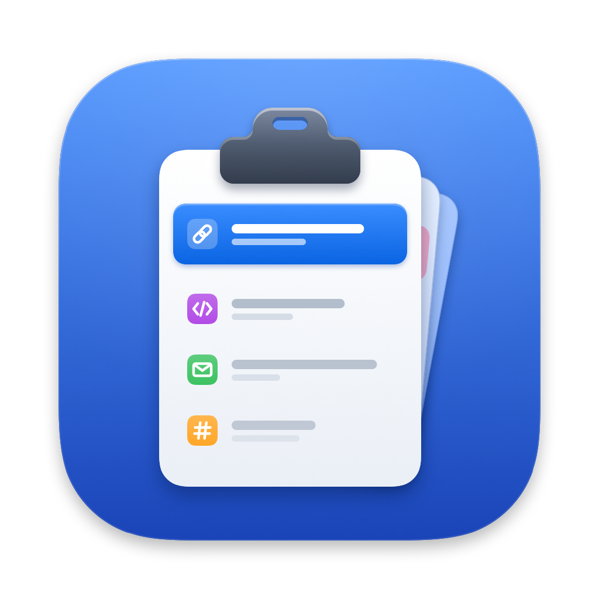
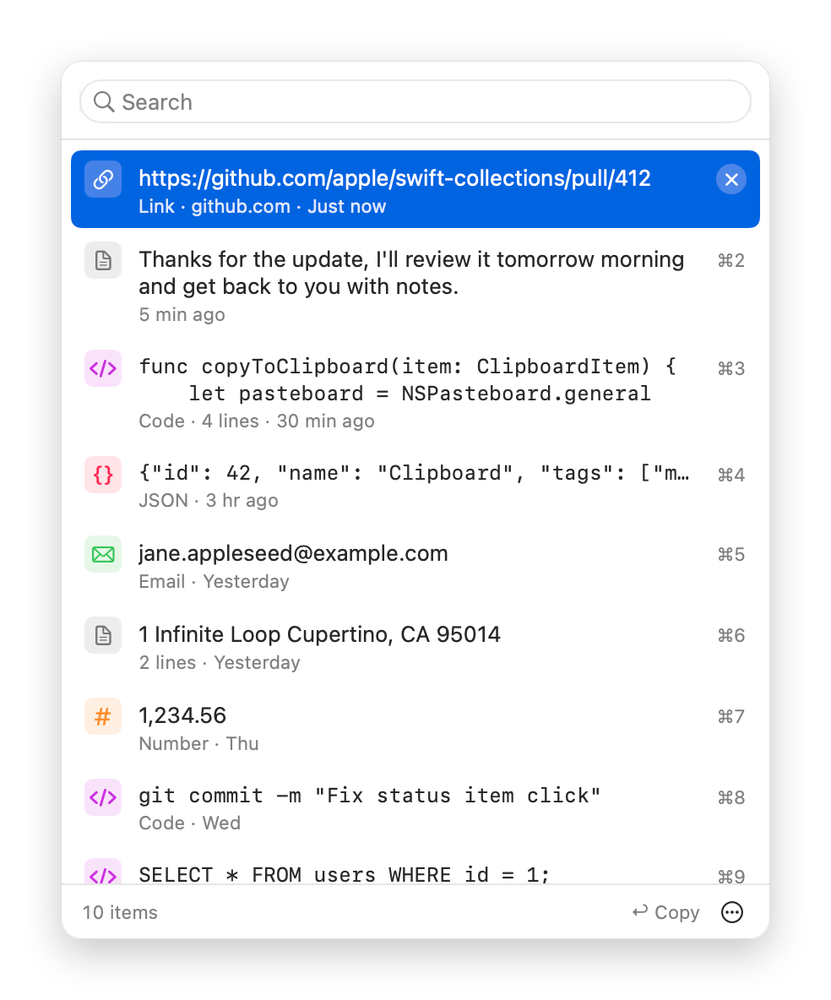
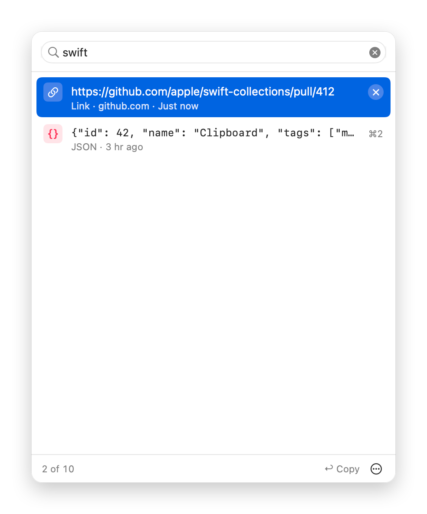
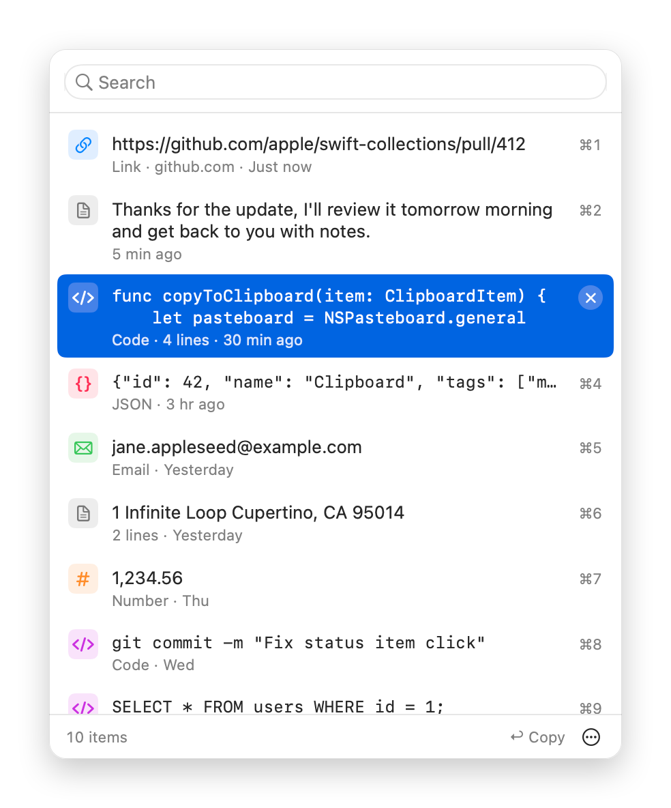
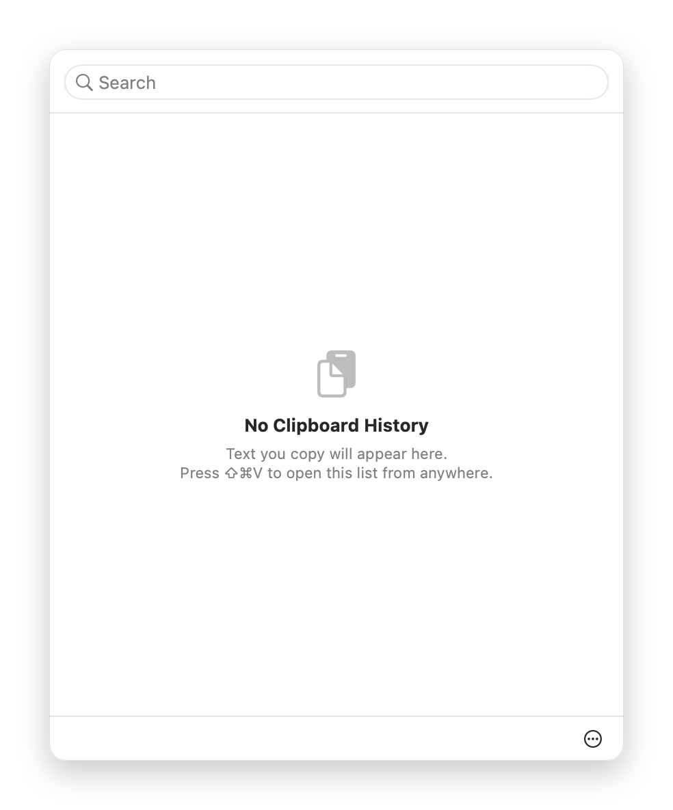

<p align="center">
  
</p>

<h1 align="center">ClipboardManager</h1>

<p align="center">
  <a href="#requirements"></a>
  <a href="https://swift.org"></a>
  <a href="https://developer.apple.com/xcode/swiftui/"></a>
  <a href="#usage"></a>
  <a href="#running-tests"></a>
  <a href="LICENSE"></a>
</p>

A lightweight macOS menu-bar app that keeps track of your clipboard history, similar to PastPal. Everything you copy is saved so you can search it and paste it again later, without leaving the keyboard.

<p align="center">
<picture>
  <source media="(prefers-color-scheme: dark)" srcset="docs/screenshots/popover-dark.png">
  
</picture>
</p>

## Features

- Automatic clipboard history that's saved between launches
- Opens from the menu bar or with a global shortcut (⇧⌘V)
- Search as you type, with full keyboard navigation
- Items labeled by type: Text, Link, Email, Number, Code, JSON
- Copying an item takes you straight back to the app you were in, ready for ⌘V
- Skips passwords and other concealed items from password managers
- Lives in the menu bar only, with no Dock icon

## Screenshots

<table>
  <tr>
    <th>Search as you type</th>
    <th>Keyboard navigation</th>
    <th>Empty history</th>
  </tr>
  <tr>
    <td>
      <picture>
        <source media="(prefers-color-scheme: dark)" srcset="docs/screenshots/search-dark.png">
        
      </picture>
    </td>
    <td>
      <picture>
        <source media="(prefers-color-scheme: dark)" srcset="docs/screenshots/keyboard-dark.png">
        
      </picture>
    </td>
    <td>
      <picture>
        <source media="(prefers-color-scheme: dark)" srcset="docs/screenshots/empty-dark.png">
        
      </picture>
    </td>
  </tr>
</table>

Screenshots follow your system appearance (light or dark).

## Requirements

- macOS 12 Monterey or later
- Command Line Tools (Swift 5.5+) to build; full Xcode isn't needed
- Running the tests needs a macOS 14+ host (they use Swift Testing). `./test.sh` handles setups that only have the Command Line Tools.

## Building & Running

```bash
git clone https://github.com/theharisshah/ClipboardManager.git
cd ClipboardManager
./build.sh
```

This builds a release binary and packages it as `dist/ClipboardManager.app`. Then:

- Run it: `open dist/ClipboardManager.app`
- Install it: drag `dist/ClipboardManager.app` into `/Applications`

Other options:

- `swift run` builds and runs a debug build, which is handy during development
- `./build.sh --clean` cleans first, then builds from scratch
- `./build.sh --dmg` builds a universal app (Apple Silicon + Intel) and packages it as `dist/ClipboardManager-<version>.dmg`, ready to attach to a GitHub release (`gh release create v<version> dist/ClipboardManager-<version>.dmg`)

The app is ad-hoc signed, not notarized, so on another Mac the first launch needs **Open Anyway** in System Settings › Privacy & Security (or Control-click › Open on macOS 12–14).

## Usage

Clipboard Manager lives in the menu bar (no Dock icon).

- **Left-click** the menu bar icon, or press **⇧⌘V** anywhere, to open the history popover.
- **Right-click** (or Control-click) the icon for the menu: **Open Clipboard History**, **Clear All History…** (asks for confirmation), **About**, and **Quit**.

### In the popover

The search field has focus as soon as the popover opens, so you can just start typing to filter.

| Key | Action |
| --- | --- |
| ↑ / ↓ (or ⌃P / ⌃N) | Move the highlight |
| Return (or click) | Copy the item, close the popover and return to the app you were in, so you can paste with ⌘V right away |
| ⌘1 – ⌘9 | Copy one of the first nine visible items |
| ⌘⌫ | Delete the highlighted item (when the search field is empty) |
| Esc | Clear the search, then close the popover |

- Right-click an item for **Copy** / **Delete**.
- The **⋯** menu in the footer has **Clear History…** (with an inline confirmation) and **Quit**.
- Items are labeled by type (Text, Link, Email, Number, Code, JSON). Code and JSON previews use a monospaced font.

> **Note:** ⇧⌘V is registered globally, so while Clipboard Manager is running it overrides "Paste and Match Style" in other apps.

## How It Works

- The pasteboard's change count is checked every 0.5 seconds, including while menus or alerts are open.
- Only plain text is stored, so rich text formatting isn't kept.
- Copying an older item moves it to the top instead of adding a duplicate.
- The newest 100 items are kept. Items longer than 10,000 characters are skipped.

## Privacy & Data

- History is stored **in plain text** in the app's preferences (UserDefaults key `ClipboardManagerItems`). The domain is the bundle id `com.theharisshah.ClipboardManager` for the `.app`, or `ClipboardManager` when run via `swift run`. On first launch, the `.app` migrates any history from the old domain.
- Items that password managers mark as concealed or transient (the [nspasteboard.org](http://nspasteboard.org) conventions `org.nspasteboard.ConcealedType`, `org.nspasteboard.TransientType` and `org.nspasteboard.AutoGeneratedType`) are never recorded.
- To wipe your history, use **Clear All History…** (it also removes the copy migrated from older builds), or run:
  ```bash
  defaults delete com.theharisshah.ClipboardManager
  defaults delete ClipboardManager   # history from builds before the .app, and from `swift run`
  ```
- **macOS 15.4+:** if macOS asks whether Clipboard Manager may paste from other apps, choose **Allow**. You can change this later in **System Settings › Privacy & Security › Paste from Other Apps**. If access is denied, the popover shows a notice.

## Running Tests

```bash
./test.sh
```

Extra arguments are passed to `swift test` (for example `./test.sh --filter SomeTest`). With full Xcode 16+ installed, plain `swift test` also works. The tests don't launch the app or touch your clipboard or saved history.

## Customization

- **Maximum number of items:** the `maxItems` parameter of `ClipboardManager`'s initializer (default 100)
- **Polling interval:** the timer in `startMonitoring()`
- **UI appearance:** the SwiftUI views in `ContentView.swift`

## Project Structure

```
ClipboardManager/
├── ClipboardManager.swift     # Model, type detection, monitoring & persistence
├── PopoverModel.swift         # Popover state & keyboard handling
├── ContentView.swift          # SwiftUI UI
├── ClipboardManagerApp.swift  # App delegate, status item, popover, menu
├── HotkeyManager.swift        # Global hotkey (⇧⌘V)
└── Info.plist                 # Bundle metadata used by build.sh
Tests/                         # Unit tests (Swift Testing)
assets/                        # App icon (AppIcon.icns, AppIcon.png)
scripts/
├── generate-icon.swift        # Draws the app icon with Core Graphics
└── make-icon.sh               # Regenerates assets/ from generate-icon.swift
docs/screenshots/              # README screenshots
build.sh                       # Builds dist/ClipboardManager.app (and the DMG with --dmg)
test.sh                        # Runs the tests
```

## License

This project is available under the MIT License. See the LICENSE file for more information.
